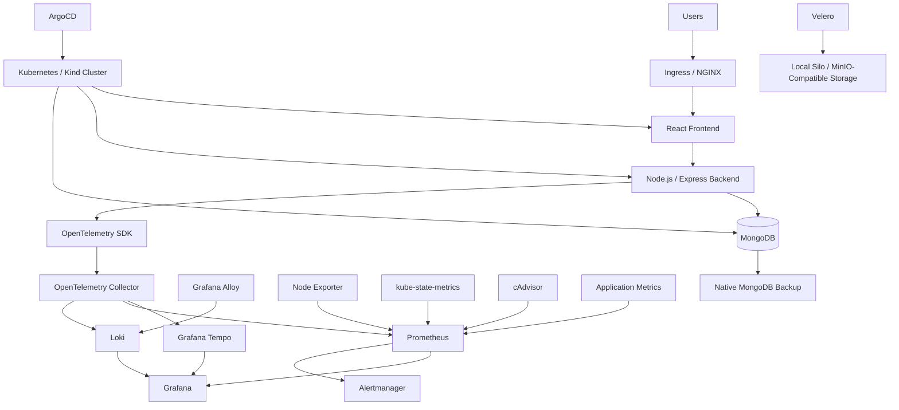

# ObserveX — Kubernetes Operations, Observability & SRE Platform

**A hands-on DevOps and Site Reliability Engineering project covering Kubernetes operations, application observability, failure troubleshooting, monitoring, alerting, performance testing, security, and disaster recovery.**

<p align="center">
  
  
  
  
  
  
</p>

---

## 1. Project Overview

ObserveX is a Kubernetes operations, observability, and SRE platform built to demonstrate how DevOps and SRE engineers deploy, monitor, troubleshoot, secure, and recover containerized applications.

The project uses an existing three-tier real-time chat application and extends it with Kubernetes orchestration, GitOps automation, OpenTelemetry instrumentation, metrics collection, centralized logging, distributed tracing, alerting, load testing, and disaster recovery workflows.

Rather than deploying isolated demonstration applications, ObserveX uses the same application throughout the project to demonstrate how operational capabilities work together.

### Project Objectives

- Deploy and manage a multi-tier application on Kubernetes.
- Automate application and infrastructure configuration through GitOps.
- Collect application, container, node, and Kubernetes metrics.
- Implement centralized logging and distributed tracing.
- Simulate common Kubernetes failures and troubleshoot them.
- Define and monitor Service Level Indicators and Service Level Objectives.
- Perform load testing and observe application autoscaling.
- Implement Kubernetes security and reliability controls.
- Back up application resources and validate recovery procedures.

## 2. Architecture



### Application Architecture

| Layer | Technology | Responsibility |
|---|---|---|
| Frontend | React, Tailwind CSS | User interface and real-time chat |
| Backend | Node.js, Express | REST APIs and application logic |
| Real-time communication | Socket.IO | Live messaging and connections |
| Database | MongoDB | Users and message storage |
| Containerization | Docker | Application container images |
| Orchestration | Kubernetes / Kind | Deployment and workload management |
| GitOps | ArgoCD | Continuous reconciliation of Git-managed manifests |

### Observability Architecture

| Component | Responsibility |
|---|---|
| OpenTelemetry SDK | Application instrumentation |
| OpenTelemetry Collector | Receives and processes telemetry |
| Prometheus | Metrics collection and querying |
| Grafana | Dashboards and visualization |
| Grafana Alloy | Kubernetes pod log collection |
| Loki | Centralized log storage and querying |
| Tempo | Distributed trace storage |
| Alertmanager | Alert routing and notifications |
| Node Exporter | Host-level metrics |
| cAdvisor | Container resource metrics |
| kube-state-metrics | Kubernetes object-state metrics |
| Metrics Server | Kubernetes resource metrics for autoscaling and operational inspection |

## 3. Technology Stack

**Cloud and Infrastructure**
- AWS EC2
- Ubuntu Linux
- Kind Kubernetes cluster
- Docker

**Kubernetes and GitOps**
- Kubernetes
- Helm
- kubectl
- ArgoCD
- Kustomize
- Ingress NGINX

**Observability**
- OpenTelemetry
- OpenTelemetry Collector
- Prometheus
- Grafana
- Grafana Alloy
- Loki
- Tempo
- Alertmanager
- Node Exporter
- cAdvisor
- kube-state-metrics
- Metrics Server

**SRE and Performance**
- k6
- PromQL
- SLI/SLO recording rules
- Kubernetes HPA
- Pod Disruption Budget

**Security and Recovery**
- Kubernetes RBAC
- NetworkPolicies
- Sealed Secrets
- Velero
- MinIO-compatible Silo storage
- MongoDB native backup and restore

**Application**
- React
- Node.js
- Express
- Socket.IO
- MongoDB

---

## 4. Implementation — All Seven Phases

## Phase 1 — Foundation and Linux Operations Toolkit

**Objective:** Establish the infrastructure and operational foundation required to run and troubleshoot Kubernetes workloads.

### What was implemented

- Provisioned an Ubuntu EC2 environment.
- Installed Docker, Git, kubectl, Kind, and Helm.
- Created a multi-node Kind Kubernetes cluster.
- Configured application and observability namespaces.
- Created reusable Bash-based Linux and Kubernetes operations scripts.
- Established baseline host and cluster resource information.

### Why it was needed

Before deploying an observability platform, an engineer needs to understand the underlying Linux host and Kubernetes environment.

CPU, memory, disk usage, running processes, pod health, and application logs are essential starting points during incident investigation.

### How it was implemented

Created reusable scripts for:

| Script | Purpose |
|---|---|
| `system-health.sh` | Collect system health information |
| `disk-monitor.sh` | Monitor disk utilization |
| `memory-monitor.sh` | Inspect memory usage |
| `process-monitor.sh` | Inspect running processes |
| `pod-health.sh` | Check Kubernetes pod health |
| `collect-logs.sh` | Collect operational logs |
| `incident-report.sh` | Generate incident reports |

### Results

- Successfully deployed the Kind cluster.
- Kubernetes nodes reached the Ready state.
- Established a baseline of host and cluster resources.
- Created a reusable Linux and Kubernetes troubleshooting toolkit.

**Deliverable:** Linux operations scripts, Kubernetes foundation, and baseline documentation.

---

## Phase 2 — Application Deployment and OpenTelemetry Instrumentation

**Objective:** Instrument the existing application to collect application-level telemetry.

### What was implemented

- Integrated OpenTelemetry into the existing Node.js backend.
- Added automatic instrumentation for supported Node.js libraries.
- Implemented HTTP request tracing.
- Implemented MongoDB client tracing.
- Instrumented Socket.IO activity.
- Added custom application metrics.
- Added Node.js runtime metrics.
- Integrated application log export.
- Deployed OpenTelemetry Collector and Grafana Tempo.
- Updated and deployed the instrumented backend container image.

### Why it was needed

Infrastructure metrics alone cannot explain everything happening inside an application.

For example, a Kubernetes pod can be healthy while application requests are slow or database operations are failing.

Application instrumentation provides visibility into request execution, database operations, runtime behavior, and errors.

### How it was implemented

The OpenTelemetry Node.js SDK was initialized through:

`backend/instrumentation.js`

Custom application metrics include:

| Metric | Purpose |
|---|---|
| `observex_http_requests_total` | Tracks HTTP requests |
| `observex_http_errors_total` | Tracks HTTP errors |
| `observex_http_request_duration_ms` | Tracks request duration |
| `observex_socket_connections_active` | Tracks active Socket.IO connections |

The backend exports OTLP telemetry to the Collector inside Kubernetes.

### Results

- HTTP and MongoDB traces were generated and verified in Tempo.
- Custom application metrics were received by the OpenTelemetry Collector.
- Node.js runtime metrics were received.
- Socket.IO connection metrics were verified during an active connection.
- Application log instrumentation and export were integrated.

**Deliverable:** An instrumented application connected to the OpenTelemetry telemetry pipeline.

---

## Phase 3 — Kubernetes Failure Simulation and Troubleshooting

**Objective:** Understand how Kubernetes behaves during common workload failures and practice systematic troubleshooting and recovery.

### What was implemented

Created and tested failure scenarios covering:

| Failure Scenario | What was investigated |
|---|---|
| CrashLoopBackOff | Container startup failures and restart behavior |
| ImagePullBackOff | Image references and image-pull failures |
| Pending Pods | Scheduling constraints and resource availability |
| OOMKilled | Container memory limits and out-of-memory termination |
| CPU Pressure | CPU resource constraints and workload behavior |
| Connectivity Failures | Service discovery and application connectivity |

### Why it was needed

Knowing Kubernetes commands is not enough for production operations.

An engineer must be able to identify why a workload is failing, inspect events and logs, isolate the root cause, apply corrective actions, and verify recovery.

### How it was implemented

Used Kubernetes operational tools such as:

```bash
kubectl get pods -A
kubectl describe pod <pod-name> -n <namespace>
kubectl get events -n <namespace> --sort-by=.lastTimestamp
kubectl logs <pod-name> -n <namespace>
kubectl get services -n <namespace>
kubectl get endpoints -n <namespace>
```

Each scenario was used to investigate the relevant Kubernetes behavior and validate recovery.

### Results

- Practiced identifying common Kubernetes workload failures.
- Investigated scheduling, image-pull, resource, and connectivity problems.
- Validated recovery behavior after corrective actions.
- Established troubleshooting experience for common Kubernetes incidents.

**Deliverable:** Practical Kubernetes failure simulation and recovery exercises.

---

## Phase 4 — Metrics Monitoring and Grafana Dashboards

**Objective:** Build centralized metrics monitoring for the application, containers, Kubernetes cluster, and underlying node.

### What was implemented

Deployed and integrated:

- Prometheus
- Grafana
- Node Exporter
- cAdvisor
- kube-state-metrics
- Kubernetes Metrics Server
- OpenTelemetry Collector metrics integration

### Why it was needed

Kubernetes provides several layers of operational information.

For example:

- Node Exporter provides host-level metrics.
- cAdvisor provides container resource metrics.
- kube-state-metrics provides Kubernetes object-state metrics.
- Application instrumentation provides application-specific metrics.

Prometheus makes it possible to collect and query these metrics centrally.

### How it was implemented

Configured Prometheus scraping and integrated metrics sources.

Used PromQL to investigate:

- CPU and memory utilization.
- Pod and container resource usage.
- Kubernetes workload health.
- Application request rates.
- Application errors.
- Request latency.
- Node resource behavior.

Created five Grafana dashboards:

| Dashboard | Purpose |
|---|---|
| ObserveX SLI/SLO Dashboard | Service-level indicators and objectives |
| Pod & Container Monitoring | Pod health and container resources |
| Application Monitoring | Application-level performance |
| Node Monitoring | Host-level resource utilization |
| Kubernetes Cluster Overview | Cluster-wide operational visibility |

### Results

- Successfully integrated infrastructure and application metric sources.
- Verified 18 Prometheus scrape targets as UP during validation.
- Queried application, node, pod, and container metrics.
- Built five Grafana dashboards for operational monitoring.

**Deliverable:** Centralized Prometheus monitoring and five Grafana dashboards.

---

## Phase 5 — Centralized Logging and Distributed Tracing

**Objective:** Extend observability beyond metrics by collecting application logs and distributed traces.

### What was implemented

- Deployed Grafana Loki.
- Deployed Grafana Alloy.
- Configured Alloy to collect Kubernetes pod logs.
- Configured Kubernetes event collection.
- Integrated Alloy with Loki.
- Integrated OpenTelemetry Collector with Loki.
- Integrated OpenTelemetry Collector with Tempo.
- Connected logs and traces for investigation in Grafana.

### Why it was needed

Metrics indicate that something is wrong, but logs and traces help explain why.

For example:

- Metrics can reveal an increase in HTTP errors.
- Logs can reveal the corresponding application error.
- Traces can identify which operation or dependency contributed to request latency.

Combining these signals improves incident investigation.

### How it was implemented

The telemetry flow was configured as follows:

```text
Kubernetes Pods
      |
      v
Grafana Alloy
      |
      v
     Loki
      |
      v
   Grafana
```

Application telemetry:

```text
Node.js Application
        |
        v
OpenTelemetry SDK
        |
        v
OpenTelemetry Collector
        |
        +------> Tempo (Traces)
        |
        +------> Prometheus (Metrics)
        |
        +------> Loki (Logs)
```

### Results

- Verified Kubernetes pod log collection through Alloy.
- Verified log delivery to Loki.
- Verified application log export.
- Verified distributed traces in Tempo.
- Used Grafana Explore to investigate logs and traces.
- Established correlation between application logs and trace/span context.

**Deliverable:** Centralized logging, distributed tracing, and multi-signal observability.

---

## Phase 6 — SRE Practices, SLI/SLO, Alerting and Load Testing

**Objective:** Apply practical SRE concepts to monitor service reliability and evaluate application performance under load.

### What was implemented

- Defined Service Level Indicators.
- Defined Service Level Objectives.
- Created Prometheus recording rules.
- Implemented error-budget calculations.
- Created Kubernetes failure alert rules.
- Configured Alertmanager notifications.
- Tested firing and resolved alert behavior.
- Performed repeated k6 load tests.
- Observed Kubernetes Horizontal Pod Autoscaler behavior.

### Why it was needed

Monitoring infrastructure alone does not establish whether a service is meeting its reliability goals.

SLIs measure service behavior, SLOs define reliability targets, and error budgets help quantify the allowed unreliability.

Load testing also helps evaluate how the application behaves under increasing traffic.

### SLI/SLO Configuration

| SLI | SLO Target |
|---|---|
| Availability | 99.9% |
| HTTP 5xx error rate | At most 0.1% |
| Requests completed under 500 ms | At least 95% |

Prometheus recording rules were configured to calculate service indicators and error-budget information over short and seven-day windows.

### Alerting

Implemented alerts for:

- Kubernetes pod CrashLoopBackOff.
- ImagePullBackOff.
- Pending pods.
- Container OOMKilled.
- High container CPU usage.
- SLI/SLO threshold violations.

Alertmanager was used to validate alert firing and resolution workflows.

### Load Testing with k6

A staged load test was performed with traffic increasing through:

```text
100 → 200 → 300 → 400 → 500 → 500 → 0 RPS
```

**Recorded test results:**

| Metric | Result |
|---|---:|
| Test duration | 8 minutes |
| Total requests | 134,131 |
| Average request rate | 279.44 requests/sec |
| Peak configured rate | 500 RPS |
| Average response time | 279.44 ms |
| p95 response time | 71.26 ms |
| Failed requests | 6 |
| Failure rate | 0.00447% |

During load testing, the backend HPA scaled the deployment up to four replicas.

### Results

- Implemented and queried SLI/SLO recording rules.
- Established availability, error-rate, and latency objectives.
- Validated alert firing and resolution.
- Completed repeated load-testing exercises.
- Observed backend autoscaling under increased traffic.

**Deliverable:** SRE monitoring, reliability objectives, alerting, and performance-testing evidence.

---

## Phase 7 — Reliability, Security and Disaster Recovery

**Objective:** Improve workload reliability, restrict unnecessary access, protect sensitive configuration, and validate backup and recovery workflows.

### What was implemented

**Reliability**

- Multiple application replicas.
- Horizontal Pod Autoscaler.
- Pod Disruption Budget.
- Kubernetes resource requests and limits.
- Health probes.

**Security**

- Kubernetes RBAC.
- Namespace and workload NetworkPolicies.
- Sealed Secrets for encrypted Kubernetes secret management.

**Backup and Recovery**

- Deployed Velero.
- Configured Silo local backup storage using MinIO-compatible object storage.
- Configured a Velero BackupStorageLocation.
- Created a Kubernetes resource backup.
- Implemented MongoDB native backup and restore.
- Created an isolated recovery namespace.
- Validated the restored database and recovery application connectivity.

### Why it was needed

Reliable applications need more than healthy pods.

They also require controlled access, resource management, disruption protection, secure secret handling, and a recovery strategy when resources or data are lost.

### Kubernetes Resource Backup

Created the Velero backup:

`observex-resource-backup`

Recorded results:

| Metric | Result |
|---|---:|
| Items backed up | 54 / 54 |
| Errors | 0 |
| Warnings | 0 |
| Backup status | Completed |

MongoDB persistent volume data was handled separately through a native MongoDB backup workflow.

### MongoDB Backup and Restore

Created a native MongoDB backup and restored it into a separate test database:

`observex_restore_test`

Verified results:

| Validation | Result |
|---|---|
| Users collection | 1 document restored |
| Messages collection | 0 documents |
| Restore failures | 0 |
| Backup checksum | Matched |
| Production database | Left unchanged |

### Isolated Recovery Environment

Created a separate namespace:

`observex-restore-test`

The recovery environment used its own MongoDB persistent volume and PVC rather than the production database volume.

Validated:

- Recovery MongoDB pod availability.
- Independent persistent storage.
- Backend-to-MongoDB connectivity.
- Frontend HTTP response.
- Frontend-to-recovery-backend routing.
- Expected unauthenticated API behavior.

### Recovery Test Transparency

The Kubernetes resource backup completed successfully with all 54 items.

One subsequent Velero restore test was reported as `PartiallyFailed` (51 items restored, with one reported error and one warning). The recovery environment and separate MongoDB restore were validated independently. Therefore, this project does not claim that every Velero restore test completed successfully.

### Results

- Implemented Kubernetes reliability controls.
- Configured RBAC and NetworkPolicies.
- Used Sealed Secrets for encrypted credentials.
- Completed a successful Velero resource backup.
- Completed MongoDB native backup and isolated restore validation.
- Verified recovery application infrastructure and connectivity without modifying production data.

**Deliverable:** Kubernetes security controls, backup infrastructure, and an isolated recovery validation workflow.

---

## 5. Project Results at a Glance

| Area | Implemented Result |
|---|---|
| Linux operations | Reusable Bash monitoring and incident scripts |
| Kubernetes | Multi-node Kind cluster |
| Application | React, Node.js, Socket.IO and MongoDB |
| GitOps | ArgoCD-managed application and observability configurations |
| Application instrumentation | OpenTelemetry SDK |
| Distributed tracing | Tempo |
| Metrics monitoring | Prometheus |
| Dashboards | Five Grafana dashboards |
| Centralized logging | Loki and Grafana Alloy |
| Alerting | Prometheus rules and Alertmanager |
| SLI/SLO | Availability, error-rate and latency objectives |
| Load testing | 134,131 requests in a detailed test |
| Autoscaling | Backend scaled to four replicas during testing |
| Reliability | HPA, PDB, probes and resource controls |
| Security | RBAC, NetworkPolicies and Sealed Secrets |
| Backup | 54/54 Kubernetes resources backed up |
| Database recovery | MongoDB native restore verified in isolation |

---

## 6. Repository Structure

```text
full-stack_chatApp/
│
├── backend/                       # Node.js application and OTel instrumentation
├── frontend/                      # React application
│
├── docs/
│   └── phase-1-foundation.md       # Foundation documentation
│
├── scripts/                       # Linux and Kubernetes operations scripts
│
├── k8s/                           # Legacy Kubernetes manifests
│
├── kubernetes/                    # Active application GitOps manifests
│   ├── applications/
│   ├── autoscaling/
│   ├── ingress/
│   ├── namespaces/
│   ├── network-policies/
│   ├── rbac/
│   ├── resources/
│   └── secrets/
│
├── observability/                 # Observability deployment configurations
│   ├── alloy-cluster-logs-values.yaml
│   ├── loki-application.yaml
│   ├── otel-collector-config.yaml
│   ├── otel-collector.yaml
│   ├── tempo-values.yaml
│   ├── minio.yaml
│   └── kustomization.yaml
│
├── velero/                        # Encrypted Velero credentials
│
├── observability-application.yaml # ArgoCD observability application
├── observex-application.yaml      # ArgoCD application deployment
├── observex-alerts-values.yml     # Kubernetes alert rules
├── observex-sli-slo-values.yml    # SLI/SLO recording rules
│
├── Jenkinsfile
├── docker-compose.yml
├── package.json
├── .gitignore
└── README.md
```

---

## 7. Environment and Deployment Notes

ObserveX was implemented on an AWS EC2 Ubuntu host running a multi-node Kind cluster.

The cluster contains a control-plane node and two worker nodes. The environment is a single-host lab, not a highly available multi-host Kubernetes production cluster.

### Important namespaces

| Namespace | Purpose |
|---|---|
| `observex` | Main application |
| `observability` | Metrics, logs, traces and monitoring infrastructure |
| `argocd` | GitOps management |
| `velero` | Backup and recovery |
| `observex-restore-test` | Isolated recovery validation |

### Accessing the application

For local testing, Kubernetes services were exposed through port forwarding.

Example:

```bash
kubectl port-forward svc/frontend -n observex 18080:80
```

Then open:

```text
http://127.0.0.1:18080
```

ArgoCD, Prometheus, Grafana, Alertmanager, Loki and Tempo were also accessed through local port forwarding during testing.

### Deployment workflow

The application and observability Kubernetes configurations are maintained in Git and reconciled through ArgoCD.

The primary GitOps application paths are:

- `kubernetes/`
- `observability/`

---

## 8. Skills Demonstrated

This project demonstrates practical experience with:

- Linux system administration and Bash scripting.
- Docker image creation and containerization.
- Kubernetes deployments, services, namespaces and storage.
- Kubernetes scheduling and failure troubleshooting.
- Helm and Kustomize configuration management.
- ArgoCD and GitOps workflows.
- OpenTelemetry application instrumentation.
- Prometheus and PromQL.
- Grafana dashboards and operational monitoring.
- Loki and centralized logging.
- Tempo and distributed tracing.
- Alertmanager and alert validation.
- SLI/SLO and error-budget concepts.
- k6 performance testing.
- Kubernetes HPA and PDB.
- RBAC and NetworkPolicies.
- Sealed Secrets.
- Velero backup and recovery.
- MongoDB backup and restore.

---

## 9. Project Scope and Limitations

ObserveX is an engineering lab and portfolio project designed to demonstrate operational workflows.

- Kubernetes runs on Kind hosted on a single EC2 machine.
- The cluster is not a multi-host highly available production cluster.
- Resource availability is constrained by the EC2 host.
- The recovery environment was validated separately from production.
- One Velero restore test was partially failed; the successful backup and independent MongoDB recovery validations are documented separately.

These limitations are explicitly stated to distinguish verified implementation results from production-grade guarantees.

---

## 10. Future Improvements

Potential extensions include:

- Exporting Grafana dashboards as version-controlled JSON.
- Automating repeatable environment bootstrap and recovery validation.
- Extending observability and performance testing to additional workloads.
- Moving the lab to a multi-node infrastructure environment for high-availability experiments.

---

## Author

**Abhinav Raj**

DevOps | Kubernetes | Cloud Infrastructure | Observability | Site Reliability Engineering

GitHub: [@avinavvv](https://github.com/avinavvv)

Project Repository: [ObserveX — full-stack_chatApp](https://github.com/avinavvv/full-stack_chatApp)

---

**ObserveX demonstrates the complete operational lifecycle of a containerized application: build, deploy, observe, troubleshoot, optimize, secure, back up, and recover.**
